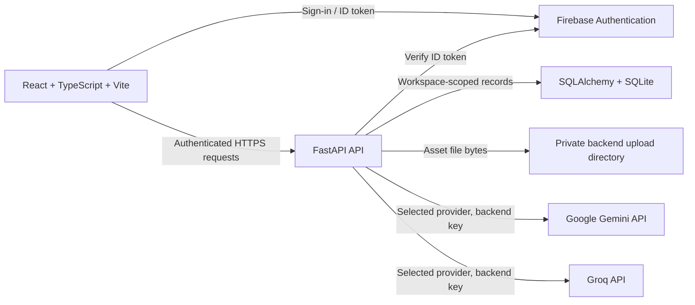

# BrandGuard AI

## Your AI Brand Safety Copilot

**Round 3 Hackathon Submission | LogicLoom**

| | |
|---|---|
| Live frontend | [brand-guard-ai-indol.vercel.app](https://brand-guard-ai-indol.vercel.app/) |
| Backend health | [brandguard-ai-ig4z.onrender.com/api/health](https://brandguard-ai-ig4z.onrender.com/api/health) |
| Source repository | [atharvbuilds2115/BrandGuard-AI](https://github.com/atharvbuilds2115/BrandGuard-AI) |
| Final report | [BrandGuard AI Round 3 Final Report](docs/BrandGuard_AI_Round_3_Final_Report.pdf) |

> **Deployment check:** the Vercel frontend returned HTTP 200 and the Render `/api/health` endpoint returned `{"status":"ok","database":"connected"}` when checked on 2026-11-03. This confirms those endpoints responded at that time; it is not a live Gemini/Groq analysis test.

## Executive summary

BrandGuard AI is a brand-safety workspace that helps marketing teams compare campaign copy and sampled video frames with approved company guidelines. It combines deterministic checks with optional Gemini or Groq analysis, preserves evidence for human review, and summarizes recurring findings across completed audits. Firebase Authentication, workspace membership, and SQL persistence provide the identity and data boundaries. The submission's automated tests and frontend checks passed; live AI analysis was not verified.

## Project overview

BrandGuard AI is a brand-safety workspace for marketing teams. It helps teams check campaign copy against documented brand rules, review sampled video frames, and compare past campaign findings for recurring risks. Reviews retain evidence and link findings to active guidelines so a reviewer can decide what to change before publication.

### Problem statement

Brand rules are often spread across guideline documents, team knowledge, and review comments. Manual checks are inconsistent, slow, and difficult to trace across campaigns. Visual content adds another challenge: brand elements and on-screen wording can change between video frames.

### Proposed solution

BrandGuard AI centralizes approved rules in isolated workspaces and makes them available to campaign, video, and cross-campaign review flows. Reviewers receive evidence, severity, and suggested corrections, while imported rules remain inactive until explicitly approved. AI-provider output is validated before it is saved; a provider failure is reported rather than replaced with a fabricated result.

### Objectives and core concept

- Make a company’s approved rules available in one workspace.
- Surface evidence-backed issues instead of unsupported model claims.
- Keep people in the review loop for ambiguous or high-impact findings.
- Reuse completed review evidence to identify recurring issues.
- Keep each workspace’s records and guidelines isolated from other companies.

BrandGuard combines deterministic checks with optional Gemini or Groq analysis. The AI provider is selected on the backend; model suggestions are validated against submitted evidence and active rules before they are stored.

## Implemented features

### Application modules

| Module | What it does |
|---|---|
| **Dashboard** | Shows workspace overview metrics and recent activity. Review records and activity are loaded from authenticated backend endpoints when Firebase is configured. |
| **Asset Library** | Uploads and lists workspace assets, stores file metadata in SQL, stores file bytes outside the repository, and supports item management and download. Text extraction is available for supported documents; image OCR is not implemented. |
| **Brand Guidelines** | Creates, edits, activates, and removes rules. Owners/admins can import PDF, DOCX, and TXT documents, review extracted rules and citations, edit/approve/reject selections, and explicitly save approved rules. |
| **Campaign Review** | Reviews campaign text against active workspace guidelines, returns evidence, severity, explanation, and suggested corrections, and stores completed audits and findings. The active provider can add validated findings when configured. |
| **Video Review** | Analyzes selected video frames against active workspace guidelines, shows timestamped findings and derived risk/compliance scores, and saves completed reviews only. |
| **Consistency Intelligence** | Compares 2–50 selected completed audits. It summarizes risk/compliance trends, recurring guideline-linked or repeated findings, severity, and evidence-backed suggestions; it does not rerun audits. |
| **Approvals** | Displays review decisions and supports approve, reject, or request-changes workflows. |
| **Activity History** | Displays workspace-scoped records of actions and review events. |
| **Settings** | Edits workspace preferences and provides workspace/member management controls. Owners/admins can invite members; invitation acceptance requires a signed-in account with the matching verified Firebase email. |
| **Global Search** | Debounced, case-insensitive partial search across campaign records, uploaded assets, and active guidelines. Results identify their category and navigate to the corresponding existing view. |
| **Authentication** | Supports Firebase email/password registration and sign-in, Google sign-in, password reset, and an optional dedicated demo account login. Demo login still uses Firebase Authentication. |

Guideline import sends extracted PDF, DOCX, or TXT text to the selected backend AI provider. Groq uses strict JSON Schema output for supported models, validates the response with Pydantic, and makes at most one bounded format-repair retry; only validated rules and source citations reach the review UI. Extracted rules remain unsaved until explicitly approved and saved by a workspace manager.

The application also includes a dedicated evaluator workspace seeding path controlled by backend configuration. Its sample records are labeled as demonstrations; the illustrative video example is not represented as an AI-analyzed review.

### Typical user journey

1. Sign in with Firebase email/password or Google authentication. Optional evaluator credentials also authenticate through Firebase.
2. Select an existing workspace, create one, or accept an invitation using the invited verified email.
3. Add guidelines or import a readable PDF, DOCX, or TXT document; edit and approve the extracted rules before saving.
4. Upload assets and submit campaign copy for review against the active workspace guidelines.
5. Inspect evidence and findings, update review statuses, and record approval decisions.
6. Submit a supported video for sampled-frame analysis; retain the selected file and retry if analysis fails.
7. Select completed audits to create a consistency report from saved campaign evidence.

## Round 3 improvements

### 1. Evidence-Based AI Brand Auditing

Campaign checks run deterministic tests for known rule categories, including prohibited or required terminology, pricing, dates, and promotional claims. If a Gemini or Groq provider is configured, it may add findings. A provider finding is accepted only when its quoted evidence occurs in the submitted text and it references an active guideline in the current workspace. Findings include severity, explanation, and suggested correction. A capped severity-weighted total is stored as a risk score; it is not an AI confidence score.

When no provider is configured, the existing rules-only path remains available. When a provider is explicitly selected but its key is missing or a provider request fails, the backend reports an error rather than inventing a successful result.

### 2. Video Review System

Authenticated users can upload MP4, MOV, M4V, AVI, or WebM videos up to **50 MB** and **180 seconds**. OpenCV samples at most **12** frames, with a bundled FFmpeg fallback for unsupported OpenCV codecs or failed seeks. Duplicate encoded frames are removed, frames are scaled to at most **768 pixels** on the longest dimension, and JPEG-encoded at quality 70. Extraction has a 25-second cap and encoded analysis images have a 12 MB limit.

Gemini analyzes frames in a bounded request with retries for transient errors, `Retry-After` handling, and a configured fallback model for eligible availability failures. Groq processes frames in sequential batches of up to three and uses strict JSON Schema output on its default Qwen vision model, followed by Pydantic and evidence validation. A single bounded format-repair retry is allowed; invalid or incomplete results are reported rather than saved. The saved response records the successful provider/model and Gemini fallback status. Findings carry timestamps, severity, and evidence; risk and compliance scores are derived from finding severities. If extraction or analysis fails, no review is saved and the browser retains the selected file for retry.

**Scope:** only sampled visual frames and legible on-screen text are analyzed. Audio transcription is not implemented.

### 3. Cross-Campaign Brand Consistency Intelligence

Users select **2–50 distinct completed audits** from the active workspace. The report compares stored findings, groups issues by guideline or normalized finding title, summarizes recurring violations and severity, and presents saved evidence and corrections. It also reports risk/compliance trends based on stored audit scores. It does not create new campaign findings or rerun audits.

## Technical architecture and data flow



The browser sends Firebase ID tokens to FastAPI. The backend verifies the token, resolves workspace membership, and scopes reads/writes to the selected workspace. Active approved workspace guidelines are supplied to campaign, video, and consistency workflows. SQLAlchemy persists application records in SQLite. Uploaded asset bytes are stored in the backend upload directory; guideline import stores document metadata and approved cited rules, not the original document bytes. Firebase Storage and Firestore are not used.

## Technology stack

| Area | Implemented technologies |
|---|---|
| Frontend | React, TypeScript, Vite, Tailwind CSS, React Router, Recharts |
| Authentication | Firebase Authentication client SDK; Firebase Admin verification in FastAPI |
| Backend | Python, FastAPI, Pydantic, SQLAlchemy |
| Database | SQLite (local/default deployment configuration) |
| AI providers | Google Gemini API and Groq API, selected by backend `AI_PROVIDER` configuration |
| Video | OpenCV headless for frame decoding, sampling, resize, duplicate filtering, and JPEG encoding |
| Document import | PyMuPDF for PDF and `python-docx` for DOCX; TXT parsed as text |
| Tests | pytest, FastAPI TestClient, temporary/in-memory SQLite, mocked provider requests |

## Repository structure

```text
.
├── backend/
│   ├── auth.py                 # Firebase Admin token verification
│   ├── database.py             # SQLAlchemy engine and additive migrations
│   ├── main.py                 # FastAPI app, CORS, router registration
│   ├── models.py               # SQLAlchemy records
│   ├── routers/                # API endpoints by application module
│   ├── services/               # AI, audit, video, guideline, workspace logic
│   ├── tests/                  # Backend automated and opt-in live tests
│   └── .env.example            # Placeholder backend settings
├── docs/
│   └── BrandGuard_AI_Round_3_Final_Report.pdf
├── src/
│   ├── App.tsx                 # Main application routes and module pages
│   ├── components/             # Authentication, guideline import, consistency UI
│   ├── data/                   # Clearly labeled demonstration data
│   ├── lib/                    # Firebase, backend API, workspace and audit clients
│   └── types/
├── .env.example                # Placeholder frontend settings
├── render.yaml                 # Render backend Blueprint
└── vercel.json                 # Vercel SPA routing
```

## Local installation and setup

### Prerequisites

- Node.js and npm compatible with the Vite version in `package.json`.
- Python 3.12 recommended; the backend test run for this submission used Python 3.12.
- A Firebase project with Email/Password and Google providers enabled for authenticated use.
- A Gemini or Groq API key only if you want to exercise live provider-backed analysis.

### Windows PowerShell

From the repository root:

```powershell
npm install
py -3.12 -m venv backend\.venv
.\backend\.venv\Scripts\Activate.ps1
python -m pip install -r backend\requirements.txt
Copy-Item .env.example .env.local
Copy-Item backend\.env.example backend\.env
```

### macOS / Linux / other POSIX shells

From the repository root:

```bash
npm install
python3 -m venv backend/.venv
source backend/.venv/bin/activate
python -m pip install -r backend/requirements.txt
cp .env.example .env.local
cp backend/.env.example backend/.env
```

Edit the local environment files with your own configuration. Do not copy real credentials into source control, documentation, frontend variables, or screenshots. The files are ignored by Git.

### Frontend environment (`.env.local`)

```dotenv
VITE_FIREBASE_API_KEY=your-public-firebase-web-api-key
VITE_FIREBASE_AUTH_DOMAIN=your-project.firebaseapp.com
VITE_FIREBASE_PROJECT_ID=your-firebase-project-id
VITE_FIREBASE_APP_ID=your-firebase-web-app-id
VITE_API_BASE_URL=http://localhost:8000
```

Firebase Web configuration is public client configuration. Never place passwords, backend API keys, Firebase Admin credentials, or service-account JSON in a `VITE_*` setting. Demo sign-in uses server-issued Firebase custom tokens; demo account email addresses and passwords belong only in the backend environment.

### Backend environment (`backend/.env`)

```dotenv
DATABASE_URL=sqlite:///./brandguard.db
UPLOAD_DIR=
MAX_UPLOAD_SIZE_MB=10

# Select one provider; only its server-side key is needed for analysis.
AI_PROVIDER=gemini
GEMINI_API_KEY=your-server-side-gemini-api-key
GEMINI_PRIMARY_MODEL=your-supported-gemini-model
GEMINI_FALLBACK_MODEL=your-supported-gemini-fallback-model
GROQ_API_KEY=your-server-side-groq-api-key
GROQ_TEXT_MODEL=your-supported-groq-text-model
GROQ_VISION_MODEL=your-supported-groq-vision-model

FIREBASE_PROJECT_ID=your-firebase-project-id
FIREBASE_SERVICE_ACCOUNT_PATH=C:/secure/path/firebase-admin.json
FRONTEND_ORIGINS=http://localhost:5173,http://127.0.0.1:5173
DEMO_CREATOR_EMAIL=creator.demo@your-domain.example
DEMO_CREATOR_PASSWORD=
DEMO_REVIEWER_EMAIL=reviewer.demo@your-domain.example
DEMO_REVIEWER_PASSWORD=
DEMO_AGENCY_EMAIL=agency.partner.demo@your-domain.example
DEMO_AGENCY_PASSWORD=
DEMO_ADMIN_EMAIL=brand.admin.demo@your-domain.example
DEMO_ADMIN_PASSWORD=
```

For local development, Firebase Admin can use Application Default Credentials or a service-account JSON stored **outside the repository**. Set `FIREBASE_PROJECT_ID` to the same Firebase project used by the web app. All four demo email settings are required to enable demo sign-in. `GEMINI_API_KEY` and `GROQ_API_KEY` must remain in the backend environment; choose provider model IDs supported by the associated API account.

### Four-role demo setup

Set all four demo emails and optional passwords in `backend/.env`, then run:

```powershell
.\backend\.venv\Scripts\python.exe scripts\setup_demo_accounts.py
```

The setup script creates or updates four distinct Firebase users, assigns trusted `brandguard_demo`, `demo_role`, and `app_role` custom claims through Firebase Admin, and adds each user only to that role's isolated demo workspace. Role sample data is seeded at the first successful login. The Brand Admin Demo has administrator permissions only inside its isolated sample workspace; demo accounts cannot create or modify real workspaces.

```dotenv
DEMO_CREATOR_EMAIL=creator.demo@your-domain.example
DEMO_CREATOR_PASSWORD=use-a-strong-secret-from-your-deployment-environment
DEMO_REVIEWER_EMAIL=reviewer.demo@your-domain.example
DEMO_REVIEWER_PASSWORD=use-a-strong-secret-from-your-deployment-environment
DEMO_AGENCY_EMAIL=agency.partner.demo@your-domain.example
DEMO_AGENCY_PASSWORD=use-a-strong-secret-from-your-deployment-environment
DEMO_ADMIN_EMAIL=brand.admin.demo@your-domain.example
DEMO_ADMIN_PASSWORD=use-a-strong-secret-from-your-deployment-environment
```

If a password is omitted, the setup script generates it and prints it once. Store demo credentials in an environment-specific secret source; do not add passwords or Firebase service-account JSON to frontend files. Each role's login page has a single role-specific demo button; the FastAPI server maps the requested role to its configured Firebase account and creates the custom token. Switching demo roles requests a new server-issued token; it does not change a frontend role value.

## Start the application

Start FastAPI in the repository root:

```powershell
python -m uvicorn backend.main:app --reload --host 127.0.0.1 --port 8000
```

If the virtual environment is not activated on Windows:

```powershell
.\backend\.venv\Scripts\python.exe -m uvicorn backend.main:app --reload --host 127.0.0.1 --port 8000
```

In another terminal:

```bash
npm run dev
```

Open the Vite URL shown in the terminal (normally `http://localhost:5173`). Add the exact local hostname to Firebase Authentication's **Authorized domains**. The API docs are available at [http://127.0.0.1:8000/docs](http://127.0.0.1:8000/docs); the health endpoint is [http://127.0.0.1:8000/api/health](http://127.0.0.1:8000/api/health).

## API overview

FastAPI registers endpoints for:

- Health, dashboard metrics, and recent activity.
- User profile and workspace settings.
- Workspace creation/listing, memberships, invitations, and verified-email invitation acceptance.
- Assets and secure uploads/downloads.
- Brand guidelines, guideline imports, and guideline history.
- Campaign audits, audit findings, and review history.
- Video reviews.
- Consistency reports.
- Approvals and activity.
- Global search.

The generated OpenAPI interface at `/docs` is the authoritative endpoint schema for a running backend. Protected API routes require a verified Firebase ID token and workspace access; the health endpoint is public.

## Authentication and workspace sharing

Firebase Authentication handles identity in the browser. The backend verifies Firebase ID tokens through Firebase Admin, checks the configured project ID, and validates revocation. An unverified UID supplied by the browser is not used as the user identity.

Each new account receives a personal workspace with the `Creator` application role. Workspace application roles are stored per membership as `creator`, `reviewer`, `agency_partner`, or `brand_admin`; they are not read from frontend state or Firebase client claims. An existing Brand Admin can invite or change Creator, Reviewer, and Agency Partner roles. Only a workspace owner can assign Brand Admin. Invitations require the exact verified Firebase email and explicit acceptance.

Creators can submit and audit campaigns, upload assets, and update findings. Reviewers can view and decide only submissions assigned to them by a Brand Admin. Agency Partners can submit and manage campaign assets in assigned client workspaces. Brand Admins can manage guidelines, workspace settings, users/roles, reports, audit history, reviewer assignments, and approvals. FastAPI checks these capabilities on protected endpoints in addition to verifying the Firebase ID token and workspace membership. A user cannot access another organization by changing the workspace header.

The original membership `owner`/`admin`/`member` field remains for compatibility. On startup, an additive SQLite migration maps existing owners/admins to Brand Admin and existing members to Creator, preserving existing accounts and records. New accounts do not self-assign elevated roles during registration. New workspaces can be created only by an existing Brand Admin.

For a brand-new deployment without a migrated owner, the trusted database operator must bootstrap the first Brand Admin after that Firebase user signs in and receives their personal workspace. For SQLite, run the following against the configured database, substituting the verified Firebase UID:

```sql
UPDATE workspace_memberships
SET role = 'owner', app_role = 'brand_admin'
WHERE user_id = '<verified-firebase-uid>'
  AND workspace_id = (
    SELECT id FROM company_workspaces
    WHERE personal_owner_uid = '<verified-firebase-uid>'
  );
```

Keep this operation restricted to trusted database operators. No additional environment variables are required.

Existing SQLite migrations are additive and preserve existing records. Legacy rows with a recorded user ID are associated with that user's personal workspace. When no prior workspace role exists, the membership starts as Creator rather than granting administrator access; records without a recorded user ID are not guessed into a workspace.

## Security and privacy

- Gemini and Groq API keys are read only by backend services and never belong in frontend code or Vercel `VITE_*` variables.
- Firebase Admin service-account JSON/credentials belong in a protected backend secret store or outside-repository path.
- Frontend Firebase Web configuration is public client configuration, not an Admin credential.
- Backend routes verify Firebase ID tokens and workspace membership; role-based permissions are checked server-side for submissions, reviews, approvals, guidelines, workspace settings, and reports.
- CORS is configured with explicit frontend origins.
- Guideline uploads are validated by extension, MIME type, signature, and size; document text is treated as untrusted input for the extraction prompt.
- Asset bytes are kept in a private backend upload directory rather than Firebase Storage. SQL records are workspace-scoped; Firebase Firestore is not used.
- Provider errors are sanitized before being returned or logged. Do not log API keys, Firebase tokens, or uploaded source content.
- AI processing sends submitted campaign text, selected video frames, or extracted guideline text to the configured external provider when that feature is used. Do not submit confidential material unless your organization permits that processing.

## Testing and verified results

Commands from the repository root:

```powershell
.\backend\.venv\Scripts\python.exe -m pytest backend\tests
npm test
npm run lint
npm run build
git diff --check
```

**Verified on 2026-11-23:**

| Check | Result |
|---|---|
| Backend automated suite | **154 passed, 1 skipped** |
| Frontend tests | **6 passed** |
| Frontend lint (`oxlint`) | **Passed** |
| Frontend TypeScript + production build | **Passed** |
| Browser demo sign-in / role switch / sign-out | **Passed; all four identities and unique Firebase UIDs were verified** |
| `git diff --check` | **Passed** |

The automated backend suite uses temporary/in-memory SQLite and mocks external provider and Firebase-dependent flows where appropriate. It includes a locally generated MP4 fixture decoded by OpenCV and mocked retry/fallback/quota/error scenarios. The one skipped test is the opt-in live integration test. **No live Gemini/Groq request or end-to-end live Firebase-authenticated analysis was performed**, so provider success and saved/retrieved live AI reviews are not claimed. The frontend build emits a non-blocking large-JavaScript-chunk warning.

To opt into the live integration test, set `BRANDGUARD_RUN_LIVE_INTEGRATION_TESTS=1`, configure a real selected-provider key, set `BRANDGUARD_FIREBASE_ID_TOKEN` to a valid test user token, and set `BRANDGUARD_TEST_MP4` to a local MP4 path. Optionally set `BRANDGUARD_SECOND_FIREBASE_ID_TOKEN` to exercise a second user's data isolation. This contacts real services and should use dedicated test accounts/data.

## Deployment

- **Frontend (Vercel):** [https://brand-guard-ai-indol.vercel.app/](https://brand-guard-ai-indol.vercel.app/)
- **Backend (Render):** [https://brandguard-ai-ig4z.onrender.com](https://brandguard-ai-ig4z.onrender.com/)
- **Repository:** [https://github.com/atharvbuilds2115/BrandGuard-AI](https://github.com/atharvbuilds2115/BrandGuard-AI)

The repository includes `vercel.json` for SPA route rewriting and `render.yaml` for a FastAPI service with persistent disk storage. Keep the Render service to one instance because SQLite is not a multi-instance database.

**Vercel frontend**

1. Import the existing GitHub repository and deploy the `main` branch.
2. Set `VITE_FIREBASE_API_KEY`, `VITE_FIREBASE_AUTH_DOMAIN`, `VITE_FIREBASE_PROJECT_ID`, and `VITE_FIREBASE_APP_ID` to the Firebase Web App values. Set `VITE_API_BASE_URL` to the deployed Render API URL (for example, `https://brandguard-ai-ig4z.onrender.com`).
3. Configure these values for each Vercel environment you deploy (Production, Preview, and Development as needed), then redeploy so Vite includes them in the build.

**Render FastAPI backend**

1. Deploy using `render.yaml`. It configures SQLite and uploads on the persistent disk; keep one service instance.
2. In Render, add the Firebase Admin service-account JSON as a secret file at `/etc/secrets/firebase-admin.json`. Set `FIREBASE_PROJECT_ID` to the same Firebase project used by the frontend.
3. Set `FRONTEND_ORIGINS` to the exact Vercel production origin and any explicitly trusted custom domain. Configure the selected server-side AI provider key (`GEMINI_API_KEY` or `GROQ_API_KEY`) and supported model IDs as needed.
4. Configure all four demo emails (`DEMO_CREATOR_EMAIL`, `DEMO_REVIEWER_EMAIL`, `DEMO_AGENCY_EMAIL`, `DEMO_ADMIN_EMAIL`) and, if desired, their corresponding password variables. These are backend-only settings; do not put demo credentials in Vercel.
5. From a secure Render Shell or controlled administrative environment with access to the same service-account credentials and persistent SQLite database, run `python scripts/setup_demo_accounts.py` once. The script is repeatable and refuses to repurpose an existing non-demo Firebase user. Restart/redeploy as needed, then verify `/api/health` and each role's demo login.

In Firebase Authentication, enable Email/Password and Google providers and add the Vercel production/custom domains to **Authorized domains**. For local development, also authorize the local hostname. The four role-specific demo email variables are required for all four demo buttons; the legacy `DEMO_ACCOUNT_EMAIL` setting is retained for older single-account demo setups.

### Production demo login troubleshooting

The demo button calls `POST /api/auth/demo-token/{role}` on `VITE_API_BASE_URL`; it sends the role in the URL and no request body. If the API responds that demo sign-in is not configured, set the matching `DEMO_CREATOR_EMAIL`, `DEMO_REVIEWER_EMAIL`, `DEMO_AGENCY_EMAIL`, or `DEMO_ADMIN_EMAIL` in the Render service's **Environment** settings. Use the exact email for the corresponding enabled Firebase Authentication user, available in Firebase Console under Authentication > Users or in the secure backend environment used to provision the demo accounts. Do not copy passwords or service-account credentials into Vercel. Save the settings and restart/redeploy the Render service. The API response and backend warning identify only the missing variable name and role, never its configured value.

Vercel's `VITE_API_BASE_URL` must be the Render service URL, and `VITE_FIREBASE_PROJECT_ID`, Render's `FIREBASE_PROJECT_ID`, and the Firebase Admin service-account project ID must all refer to the same Firebase project. Vite settings are build-time values, so redeploy Vercel only if its frontend settings change; changing demo email variables requires a Render restart/redeploy.

The deployment uses a distinct database; local records and uploaded files are not automatically migrated. Current local checks do not certify live production authentication or AI analysis.

## Known limitations and incomplete items

- Video analysis reviews sampled visual frames and legible text only; audio transcription is not implemented.
- Scanned/image-only guideline PDFs and image OCR are not supported. Guideline import requires readable PDF, DOCX, or TXT text.
- Global search returns a bounded number of results per category (five) by design.
- SQLite deployment is intended for a single backend instance; multi-instance scaling requires a different database approach.
- The live Gemini/Groq integration path remains unverified in this test run. The live integration test was skipped because it is opt-in and needs real credentials, a Firebase token, and an MP4.
- Dashboard visualizations include locally defined display data in the client; treat those chart examples as illustrative rather than as independently verified business analytics.

## Future roadmap

These are proposed directions, not current features:

1. Replace SQLite with a managed production database before multi-instance scaling.
2. Add optional audio transcription and synchronized audio/video review.
3. Add richer search filters and pagination for large workspaces.
4. Add workspace-level policy versioning, change comparison, and export.
5. Add monitoring for provider latency, quota exhaustion, and review throughput without recording secrets or source content.
6. Expand end-to-end tests against dedicated staging Firebase and provider projects.

## Conclusion

BrandGuard AI brings brand guidelines, evidence-based campaign checks, sampled video review, approvals, and cross-campaign insights into one authenticated workspace. Automated results remain traceable to saved evidence and active rules, while failed AI requests are reported rather than presented as successful analysis. The automated test suite and frontend checks passed for this submission; live Gemini/Groq analysis and authenticated end-to-end production workflows remain unverified.

## Team

**LogicLoom** — Atharv, Om, and Sumit.
